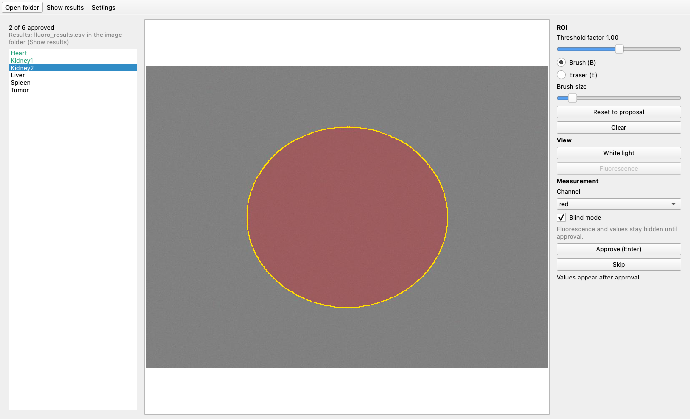

# fluoro

fluoro measures fluorescence intensity in pairs of **white-light** and **fluorescence** images, for example ex vivo
organ images from a fluorescence camera or endoscope. You draw a region of interest (ROI) on the white-light image,
and fluoro reports the mean intensity of the fluorescence image inside that ROI.



## Installation

1. Install **Python 3.11 or newer** from [python.org](https://www.python.org/downloads/).
   On Windows, tick **"Add python.exe to PATH"** during installation.
2. Open a terminal (macOS: *Terminal*, Windows: *Command Prompt*) and run

   ```
   python -m pip install https://github.com/Bananenwerfer/fluoro/archive/refs/heads/main.zip
   ```

   On macOS, write `python3` instead of `python`. The installation needs about 500 MB of disk space, mostly for the Qt window toolkit.
3. Start fluoro by typing

   ```
   fluoro
   ```

## Preparing your images

Put all images of one experiment into **one folder**. Each pair consists of two files with the same name and the
endings `_WL` (white light) and `_FL` (fluorescence):

```
Liver_WL.jpg     Liver_FL.jpg
Tumor_WL.jpg     Tumor_FL.jpg
Mouse3_Kidney_WL.png     Mouse3_Kidney_FL.png
```

- Both images of a pair must have the same size and show the same field of view.
- Supported formats: JPEG, PNG and TIFF with 8 bits per channel.
- Different endings (for example `_white` and `_fluo`) can be set under **Settings**.
- Files without a partner, with different sizes or with 16-bit depth are listed in orange with the reason and are
  not analyzed.

## Workflow

1. Click **Open folder** and choose your folder. The list on the left shows all pairs.
2. fluoro proposes an ROI on the white-light image (yellow outline).
   - **Threshold factor** makes the proposal larger or smaller.
   - **Brush** (key B) adds to the ROI, **Eraser** (key E) removes from it. **Brush size** sets the size.
   - **Reset to proposal** discards your changes, **Clear** empties the ROI so you can draw it completely by hand.
   - Zoom with the mouse wheel; hold the space bar and drag to move the image.
3. Press **Approve** (or Enter). The values appear on the right, and the fluorescence image can now be viewed.
4. Go to the next pair with the right arrow key (left arrow: previous pair), or click a name in the list.
   **Skip** marks a pair you do not want to analyze.

**Blind mode** (on by default) keeps the fluorescence image and the values hidden until you approve the ROI, so the
brightness of the signal cannot influence how you draw the ROI. You can switch it off; the results table records
for every pair whether the ROI was drawn blind.

Green names are approved, grey names are skipped. You can close fluoro at any time; when you open the same folder
again, you continue where you stopped.

## Results

fluoro saves everything inside the opened folder (**Show results** opens it):

- `fluoro_results.csv`: one row per approved pair (opens in Excel or any spreadsheet program).
- `fluoro_rois/`: the approved ROIs as images (`<name>.png`) with a small description file (`<name>.json`).

| Column | Meaning |
|---|---|
| `name`, `wl_file`, `fl_file` | pair name and image files |
| `channel` | measured channel of the fluorescence image |
| `mean` | mean intensity inside the ROI (0 to 255) |
| `min`, `max` | lowest and highest pixel value inside the ROI |
| `area_px` | ROI size in pixels |
| `n_saturated`, `flag_saturation` | pixels at 255; flag is `true` if more than 0.1 % of the ROI is saturated |
| `blind` | `true` if the fluorescence image was not viewed before approval |
| `threshold_factor`, `edited` | proposal setting and whether the ROI was changed by hand |
| `approved_at`, `fluoro_version` | time of approval and program version |

If an image is replaced after its ROI was approved, fluoro notices it (red name) and asks you to approve the ROI
again.

## How the measurement works

- **ROI proposal:** tissue is separated from a grey background by color saturation of the white-light image. Pixels
  brighter than a minimum (HSV value above 40) are thresholded with Otsu's method (times the threshold factor),
  followed by morphological opening (3 iterations) and closing (6 iterations), hole filling and removal of pieces
  smaller than 0.2 % of the image. The proposal is only a starting point; only the approved ROI is measured.
- **Intensity:** mean of the selected channel of the fluorescence image over all pixels of the approved ROI.
  Grayscale uses the ITU-R 601-2 luma conversion. No background is subtracted.
- fluoro reports values in the units of the image (0 to 255). Whether these values are comparable between images
  depends on your camera: settings such as exposure, gain and laser power must be identical, and automatic gain
  must be off or taken into account.

## Citation

If you use fluoro, please cite: [manuscript citation].

## License

MIT, see [LICENSE](LICENSE).
